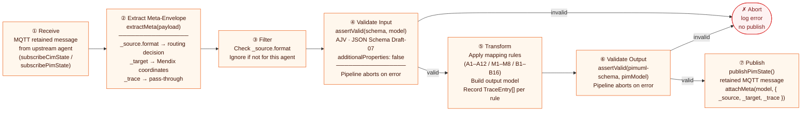
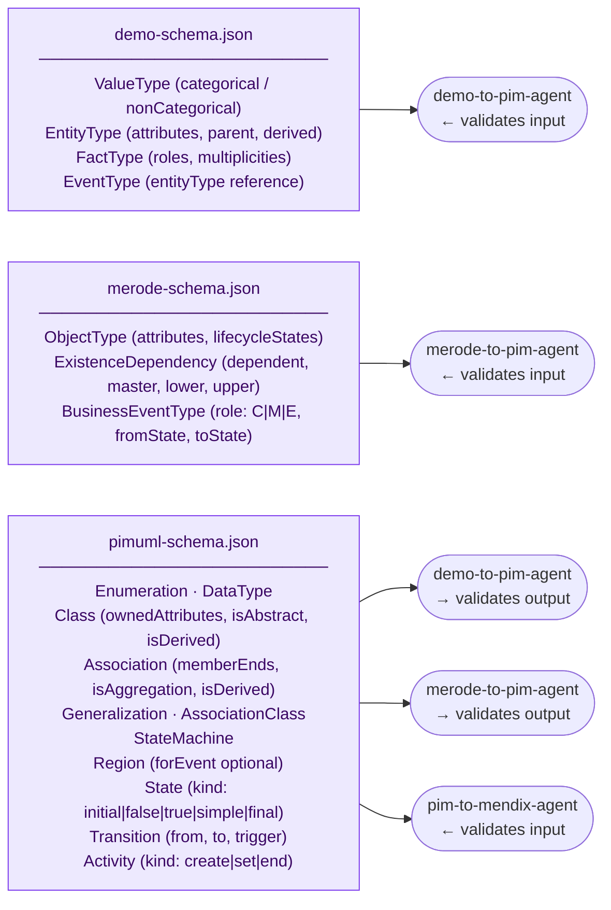
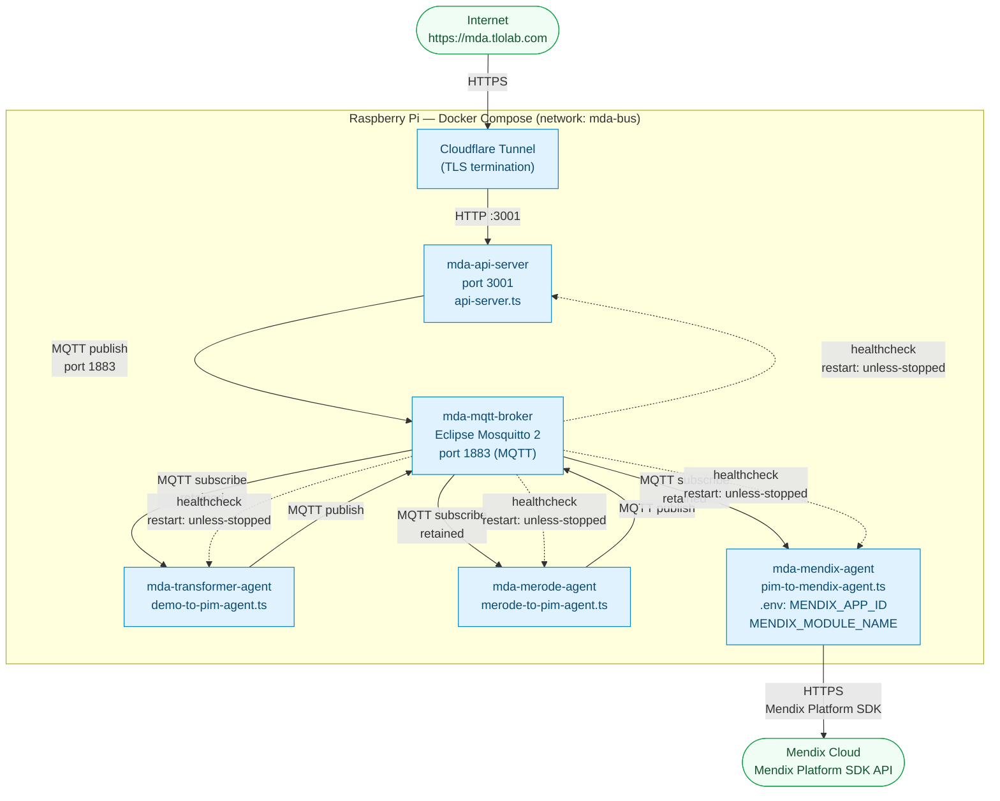

# Architekturübersicht — MDA Modelling Bus Prototyp

Dieses Dokument beschreibt die technische Architektur des für diese Masterarbeit implementierten Prototyps. Das System automatisiert die Transformation heterogener Enterprise-Modelle (aktuell DEMO und MERODE) in Mendix Low-Code-Applikationen nach dem MDA-Abstraktionshierarchie-Prinzip.

---

## 1. Ende-zu-Ende-Pipeline

Die Pipeline implementiert drei MDA-Abstraktionsschichten, verbunden durch einen asynchronen Nachrichtenbus. Quellmodelle treten auf CIM-Ebene ein, werden in eine gemeinsame PIM-Repräsentation transformiert und dann als Mendix-Applikation auf PSM-Ebene realisiert.

```mermaid
flowchart TB
    classDef cim    fill:#dbeafe,stroke:#2563eb,color:#1e3a5f,font-weight:bold
    classDef pim    fill:#dcfce7,stroke:#16a34a,color:#14532d,font-weight:bold
    classDef psm    fill:#fef9c3,stroke:#ca8a04,color:#713f12,font-weight:bold
    classDef bus    fill:#f3e8ff,stroke:#9333ea,color:#4a044e
    classDef agent  fill:#fff7ed,stroke:#ea580c,color:#431407
    classDef ext    fill:#f8fafc,stroke:#94a3b8,color:#334155

    USER(["External System / User\n─────────────\ncurl · REST client\n· tool adapter"]):::ext

    %% ── CIM Layer ──────────────────────────────────────────────────────────────
    subgraph CIM ["① CIM — Conceptual Information Models"]
        direction LR
        DEMO_IN["DEMO Fact Model\n─────────────────\n· entityTypes\n· valueTypes (categorical / non-categorical)\n· factTypes (with multiplicities)\n· eventTypes\n· attributeTypes\n─────────────────\nSchema: demo-schema.json"]:::cim
        MERODE_IN["MERODE Domain Model\n─────────────────\n· objectTypes + attributes\n· existenceDependencies\n· businessEventTypes (C / M / E)\n· lifecycleStates\n─────────────────\nSchema: merode-schema.json"]:::cim
    end

    %% ── API Gateway ─────────────────────────────────────────────────────────────
    API["② API Gateway  —  api-server\n─────────────────────────────\nHTTP  POST /api/model\nHeader  X-Input-Format: demo | merode\nOptional  X-Mendix-App-Id, X-Mendix-Module-Name\n─────────────────────────────\nWraps payload in meta-envelope:\n{ payload, _source.format, _target? }"]:::agent

    %% ── Bus: CIM Artefact ───────────────────────────────────────────────────────
    MQTT_CIM[/"③ Modelling Bus  —  Eclipse Mosquitto MQTT\n──────────────────────────────────────────────────\nArtefact ID:  model.cim.raw\nTopic:  big/bus-version-1.0/dev/api-server/artefacts/json/model.cim.raw/cim-v1.0-v1.0/state\nDelivery:  retained — agents receive last model immediately on (re)connect"/]:::bus

    %% ── CIM → PIM Agents ────────────────────────────────────────────────────────
    subgraph AGENTS ["④ CIM → PIM Transformation  (agents run independently, in parallel)"]
        direction LR

        subgraph DA ["demo-to-pim-agent"]
            DA1["Filter: _source.format === 'demo'"]:::agent
            DA2["Validate input\n(demo-schema.json · AJV)"]:::agent
            DA3["Transform: A1–A12\n────────────────\nA1  Categorical VT → Enumeration\nA2  NonCategorical VT → DataType\nA3  EntityType → Class + ID\nA4  DerivedEntityType → Class\nA5  AttributeType → Property\nA6  EventType → Boolean FSM Region\nA7  EventTriggeredSpec. → Assoc + Activity\nA8  AssocValueType → AssociationClass\nA9  DerivedSpec. → DerivedAssociation\nA10 Generalization → Inheritance\nA11 AggregationFact → Aggregation\nA12 FactType → Association"]:::agent
            DA4["Validate output\n(pimuml-schema.json · AJV)"]:::agent
        end

        subgraph MA ["merode-to-pim-agent"]
            MA1["Filter: _source.format === 'merode'"]:::agent
            MA2["Validate input\n(merode-schema.json · AJV)"]:::agent
            MA3["Transform: M1–M8\n────────────────\nM1  ObjectType → Class + Integer ID\nM2  Attribute → Property\nM4  ExistenceDependency → Association\nM5  lifecycleStates → sequential StateMachine\n    { __initial, s1, …, sN, __final }\nM6  C-Event → transition __initial → s1\nM7  M-Event → transition si → sj\nM8  E-Event → transition sN → __final"]:::agent
            MA4["Validate output\n(pimuml-schema.json · AJV)"]:::agent
        end
    end

    %% ── PIM Artefact ────────────────────────────────────────────────────────────
    subgraph PIM_LAYER ["⑤ PIM — Platform-Independent Model  (pimUML)"]
        MQTT_PIM[/"Modelling Bus  —  Eclipse Mosquitto MQTT\n────────────────────────────────────────────────────────────────────\nArtefact ID:  model.pim.created\nTopic:  big/bus-version-1.0/dev/{cim-agent}/artefacts/json/model.pim.created/pimuml-v1.0-v1.0/state\nDelivery:  retained   +   _trace[] envelope (traceability)"/]:::bus
        PIM_STRUCT["pimUML Model (JSON)\n────────────────────────────────────────────────────\nenumerations  — named literals\ndataTypes     — opaque scalar types\nclasses       — name, ownedAttributes, isAbstract, isDerived\nassociations  — memberEnds with name, type, lower, upper\ngeneralizations — child / parent\nassociationClasses — triggerEvent, memberEnds, ownedAttributes\nstateMachines — regions · states · transitions · activities\n────────────────────────────────────────────────────\nState.kind: initial | false | true | simple | final\nActivity.kind: create | set | end\nRegion.forEvent: present (DEMO) | absent (MERODE)"]:::pim
    end

    %% ── PIM → PSM Agent ─────────────────────────────────────────────────────────
    subgraph MXA ["⑥ PIM → PSM Transformation"]
        MX_AGENT["pim-to-mendix-agent\n──────────────────────────────────────────────\nSubscribes to all CIM agents via PIM_SOURCE_AGENTS env var\nDiscriminates DEMO vs MERODE FSMs via isMerodeFSM()\n──────────────────────────────────────────────\nB1   Enumeration → Mendix Enumeration + captions\nB2   DataType → Mendix Entity\nB3   Class → Mendix Entity\nB4   Property → Mendix Attribute (typed)\nB5   Enum type → EnumerationAttributeType\nB6   Boolean type → BooleanAttributeType\nB7   String/other → StringAttributeType\nB8   Association → Mendix Association\nB10  Generalization → Mendix Entity Inheritance\nB11  AssociationClass → Entity + 2 Associations\nB12  Overview Page per entity\n──── MERODE-specific ─────────────────────────\nB13  Entity_Status Enumeration + status attribute\nB14  Create_Entity Microflow (creates + sets status)\nB15  Set_Entity_Event Microflow (updates status)\nB16  End_Entity Microflow (stub — lifecycle end)"]:::agent
        MX_SDK["Mendix Platform SDK\n(TypeScript · mendixmodelsdk)\nOnline Working Copy"]:::ext
    end

    %% ── PSM Layer ───────────────────────────────────────────────────────────────
    subgraph PSM ["⑦ PSM — Mendix Application"]
        MX_APP["Mendix Application\n──────────────────────\nDomain Model\n  · Entities + Attributes\n  · Associations\n  · Enumerations\nMicroflows\n  · Create / Set / End\nOverview Pages\nNavigation"]:::psm
    end

    %% ── Edges ───────────────────────────────────────────────────────────────────
    USER         -->|"HTTP POST\n/api/model"| API
    DEMO_IN      -->|"JSON body"| API
    MERODE_IN    -->|"JSON body"| API
    API          -->|"publishCimState()\nretained MQTT message"| MQTT_CIM
    MQTT_CIM     -->|"subscribeCimState()"| DA1
    MQTT_CIM     -->|"subscribeCimState()"| MA1
    DA1 --> DA2 --> DA3 --> DA4
    MA1 --> MA2 --> MA3 --> MA4
    DA4          -->|"publishPimState()\n+ _trace[]"| MQTT_PIM
    MA4          -->|"publishPimState()\n+ _trace[]"| MQTT_PIM
    MQTT_PIM     --- PIM_STRUCT
    PIM_STRUCT   -->|"subscribePimState()"| MX_AGENT
    MX_AGENT     --> MX_SDK
    MX_SDK       --> MX_APP
```



---

## 2. Internes Verarbeitungsmuster eines Agenten

Jeder Agent -- ob CIM-nach-PIM oder PIM-nach-PSM -- folgt demselben internen Verarbeitungsmuster. Diese einheitliche Struktur wird durch die gemeinsam genutzte Infrastruktur aus `bus-client.ts` und `agent-utils.ts` erzwungen.



---

## 3. Schema-Hierarchie und Validierung

Schema-Validierung ist ein zentrales Anliegen. Jede Grenze in der Pipeline wird durch ein mit AJV kompiliertes JSON-Schema abgesichert (`additionalProperties: false`). Die Pipeline bricht ohne Veröffentlichung ab, wenn eine Validierung fehlschlägt.



Das pimUML-Schema ist der einzige gemeinsame Vertrag zwischen allen CIM-Agenten und dem PSM-Agenten. Als MERODE hinzugefügt wurde, wurde das Schema additiv erweitert (neue `kind`-Enum-Werte, `forEvent` optional) -- kein bestehendes DEMO-generiertes PIM-Dokument muss angepasst werden.

---

## 4. MQTT-Topic-Struktur

Der Bus folgt der BIG Modelling Bus-Namenskonvention (Schicht 1 der Go-Referenzimplementierung). Jeder Agent schreibt in seinen eigenen Namensraum; Schreibtopics werden nie geteilt.

```
{prefix}/{bus-version}/{environmentID}/{agentID}/artefacts/json/{artefactID}/{jsonVersion}/state
```

| Feld | Wert (dieser Prototyp) |
|------|----------------------|
| `prefix` | `big` |
| `bus-version` | `bus-version-1.0` |
| `environmentID` | `dev` |
| `agentID` | `api-server`, `demo-to-pim-agent`, `merode-to-pim-agent`, `pim-to-mendix-agent` |
| `artefactID` | `model.cim.raw`, `model.pim.created` |
| `jsonVersion` | `cim-v1.0-v1.0`, `pimuml-v1.0-v1.0` |
| `state` | retained -- neu gestartete Agenten erhalten sofort das letzte bekannte Modell |

Vollständige Beispiel-Topics:
```
big/bus-version-1.0/dev/api-server/artefacts/json/model.cim.raw/cim-v1.0-v1.0/state
big/bus-version-1.0/dev/demo-to-pim-agent/artefacts/json/model.pim.created/pimuml-v1.0-v1.0/state
big/bus-version-1.0/dev/merode-to-pim-agent/artefacts/json/model.pim.created/pimuml-v1.0-v1.0/state
```

Der PSM-Agent abonniert die PIM-Topics beider CIM-Agenten. Die Menge der vorgelagerten Agenten wird über die Umgebungsvariable `PIM_PUBLISHER_AGENT_IDS` gesteuert. Das Hinzufügen eines dritten CIM-Agenten erfordert nur die Aktualisierung dieser Variable, keine Code-Änderungen am PSM-Agenten.

---

## 5. Deployment-Sicht

Alle Komponenten laufen als Docker-Container auf einem Raspberry Pi. Der öffentliche Zugang erfolgt über einen Cloudflare-Tunnel, der TLS terminiert und HTTPS-Verkehr an das lokale API-Gateway weiterleitet.



CI/CD: Ein GitHub-Actions-Workflow (`deploy-pi.yml`) deployed den Stack automatisch bei jedem Push auf `main`. Der Workflow verbindet sich per SSH mit dem Pi, zieht das aktuelle Image und führt `docker compose up -d` aus.

---

## 6. Erweiterbarkeit

Die Architektur ist darauf ausgelegt, neue CIM-Sprachen aufzunehmen, ohne bestehende Komponenten zu ändern. Die MERODE-Integration liefert den konkreten Nachweis.

| Komponente | Änderung beim Hinzufügen von MERODE |
|------------|-------------------------------------|
| `demo-to-pim-agent.ts` | Keine Änderungen |
| `bus-client.ts` | Keine Änderungen |
| `agent-utils.ts` | Keine Änderungen |
| `merode-to-pim-agent.ts` | Neue Datei (vollständig additiv) |
| `merode-schema.json` | Neue Datei (vollständig additiv) |
| `pimuml-schema.json` | Additive Erweiterung (neue `kind`-Werte, `forEvent` optional) |
| `types.ts` | Neue Interfaces und kleine Typerweiterungen |
| `pim-to-mendix-agent.ts` | Neue B13-B16-Regelblöcke und `isMerodeFSM()`-Diskriminator |
| `docker-compose.yml` | Ein neuer Service-Block |

Ein geplantes Dritte-Agenten-Experiment (ER-Diagramm-Sprache) prognostiziert null Änderungen an bestehenden Dateien, weil ER-Konzepte auf bestehende pimUML-Konstrukte (Classes, Associations) abbilden, die B1-B12 bereits verarbeiten.

Die Grenzlinie der Erweiterbarkeit: das Hinzufügen einer Sprache mit bestehenden PIM-Konzepten (Klassen, Assoziationen, Attribute) erfordert nur einen neuen CIM-Agenten. Das Hinzufügen einer Sprache mit genuinen neuen PIM-Konzepten (wie MERODEs sequenzielle FSMs) erfordert zusätzlich eine minimale additive Schema-Erweiterung und neue PSM-Regeln.

---

## 7. Meta-Envelope

Jede Nachricht auf dem Bus trägt neben der Modell-Nutzlast einen Meta-Envelope. Der Envelope wird vor der Schema-Validierung abgetrennt und danach wieder angehängt, damit `additionalProperties: false` nicht verletzt wird.

```
{
  ...Modell-Nutzlast...,
  "_source": { "format": "demo" | "merode" },
  "_target": {
    "appId":      "<Mendix-App-UUID>",
    "moduleName": "<Modulname>",
    "branch":     "<Branch>"
  },
  "_trace": [
    {
      "sourceType": "EntityType",
      "sourceName": "Rental",
      "targetType": "Class",
      "targetName": "Rental"
    },
    ...
  ]
}
```

Das `_trace`-Array liefert vollständige Ende-zu-Ende-Nachvollziehbarkeit: jede Regelanwendung wird als `TraceEntry` aufgezeichnet. Einträge mit `targetType: "NotMapped"` dokumentieren explizit, welche Quellkonzepte außerhalb des Scopes liegen (z.B. M9-Propagierung, abgeleitete OCL-Attribute).
