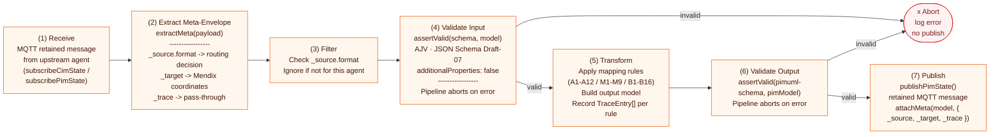
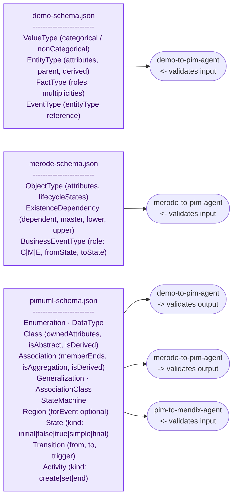
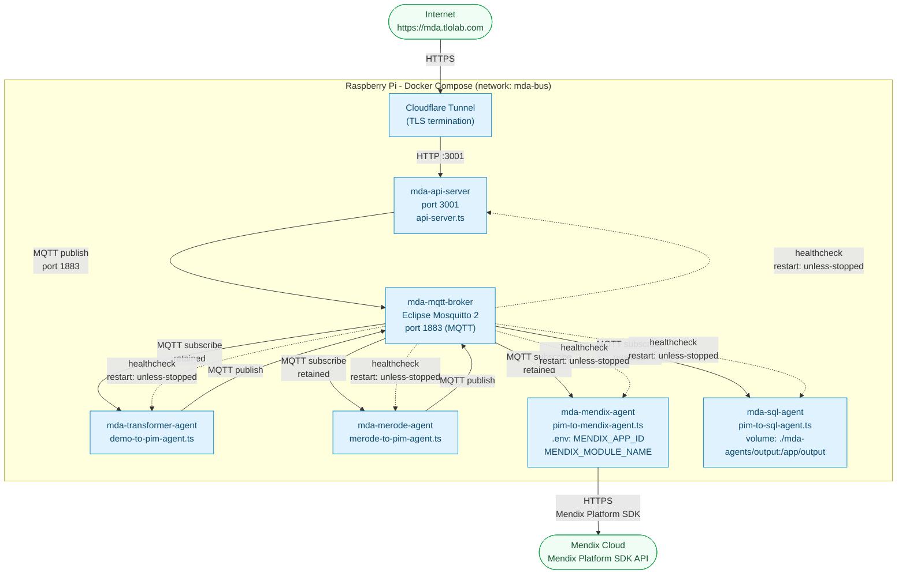

# Architecture Overview: MDA Modelling Bus Prototype

This document covers the technical architecture of the prototype built for my thesis. The system takes enterprise models (currently DEMO and MERODE) and transforms them into Mendix low-code apps, following the MDA abstraction hierarchy.

---

## 1. End-to-End Pipeline

The pipeline implements three MDA layers connected by an async message bus. Source models come in at the CIM level, get transformed into a shared PIM representation, and land as a Mendix app at the PSM level.

```mermaid
flowchart TB
    classDef cim    fill:#dbeafe,stroke:#2563eb,color:#1e3a5f,font-weight:bold
    classDef pim    fill:#dcfce7,stroke:#16a34a,color:#14532d,font-weight:bold
    classDef psm    fill:#fef9c3,stroke:#ca8a04,color:#713f12,font-weight:bold
    classDef bus    fill:#f3e8ff,stroke:#9333ea,color:#4a044e
    classDef agent  fill:#fff7ed,stroke:#ea580c,color:#431407
    classDef ext    fill:#f8fafc,stroke:#94a3b8,color:#334155

    USER(["External System / User\n-------------\ncurl · REST client\n· tool adapter"]):::ext

    %% -- CIM Layer --------------------------------------------------------------
    subgraph CIM ["(1) CIM - Conceptual Information Models"]
        direction LR
        DEMO_IN["DEMO Fact Model\n-----------------\n· entityTypes\n· valueTypes (categorical / non-categorical)\n· factTypes (with multiplicities)\n· eventTypes\n· attributeTypes\n-----------------\nSchema: demo-schema.json"]:::cim
        MERODE_IN["MERODE Domain Model\n-----------------\n· objectTypes + attributes\n· existenceDependencies\n· businessEventTypes (C / M / E)\n· lifecycleStates\n-----------------\nSchema: merode-schema.json"]:::cim
    end

    %% -- API Gateway -------------------------------------------------------------
    API["(2) API Gateway  -  api-server\n-----------------------------\nHTTP  POST /api/model\nHeader  X-Input-Format: demo | merode\nOptional  X-Mendix-App-Id, X-Mendix-Module-Name\n-----------------------------\nWraps payload in meta-envelope:\n{ payload, _source.format, _target? }"]:::agent

    %% -- Bus: CIM Artefact -------------------------------------------------------
    MQTT_CIM[/"(3) Modelling Bus  -  Eclipse Mosquitto MQTT\n--------------------------------------------------\nArtefact ID:  model.cim.raw\nTopic:  big/bus-version-1.0/dev/api-server/artefacts/json/model.cim.raw/cim-v1.0-v1.0/state\nDelivery:  retained - agents receive last model immediately on (re)connect"/]:::bus

    %% -- CIM -> PIM Agents --------------------------------------------------------
    subgraph AGENTS ["(4) CIM -> PIM Transformation  (agents run independently, in parallel)"]
        direction LR

        subgraph DA ["demo-to-pim-agent"]
            DA1["Filter: _source.format === 'demo'"]:::agent
            DA2["Validate input\n(demo-schema.json · AJV)"]:::agent
            DA3["Transform: A1-A12\n----------------\nA1  Categorical VT -> Enumeration\nA2  NonCategorical VT -> DataType\nA3  EntityType -> Class + ID\nA4  DerivedEntityType -> Class\nA5  AttributeType -> Property\nA6  EventType -> Boolean FSM Region\nA7  EventTriggeredSpec. -> Assoc + Activity\nA8  AssocValueType -> AssociationClass\nA9  DerivedSpec. -> DerivedAssociation\nA10 Generalization -> Inheritance\nA11 AggregationFact -> Aggregation\nA12 FactType -> Association"]:::agent
            DA4["Validate output\n(pimuml-schema.json · AJV)"]:::agent
        end

        subgraph MA ["merode-to-pim-agent"]
            MA1["Filter: _source.format === 'merode'"]:::agent
            MA2["Validate input\n(merode-schema.json · AJV)"]:::agent
            MA3["Transform: M1-M9\n----------------\nM1  ObjectType -> Class + Integer ID\nM2  Attribute -> Property\nM3  Enum/custom-domain Attribute -> Enumeration / DataType\nM4  ExistenceDependency -> Association\nM5  lifecycleStates -> sequential StateMachine\n    { __initial, s1, ..., sN, __final }\nM6  C-Event -> transition __initial -> s1\nM7  M-Event -> transition si -> sj\nM8  E-Event -> transition sN -> __final\nM9  Shared participation -> propagated transitions in owner FSMs"]:::agent
            MA4["Validate output\n(pimuml-schema.json · AJV)"]:::agent
        end
    end

    %% -- PIM Artefact ------------------------------------------------------------
    subgraph PIM_LAYER ["(5) PIM - Platform-Independent Model  (pimUML)"]
        MQTT_PIM[/"Modelling Bus  -  Eclipse Mosquitto MQTT\n--------------------------------------------------------------------\nArtefact ID:  model.pim.created\nTopic:  big/bus-version-1.0/dev/{cim-agent}/artefacts/json/model.pim.created/pimuml-v1.0-v1.0/state\nDelivery:  retained   +   _trace[] envelope (traceability)"/]:::bus
        PIM_STRUCT["pimUML Model (JSON)\n----------------------------------------------------\nenumerations  - named literals\ndataTypes     - opaque scalar types\nclasses       - name, ownedAttributes, isAbstract, isDerived\nassociations  - memberEnds with name, type, lower, upper\ngeneralizations - child / parent\nassociationClasses - triggerEvent, memberEnds, ownedAttributes\nstateMachines - regions · states · transitions · activities\n----------------------------------------------------\nState.kind: initial | false | true | simple | final\nActivity.kind: create | set | end\nRegion.forEvent: present (DEMO) | absent (MERODE)"]:::pim
    end

    %% -- PIM -> PSM Agents --------------------------------------------------------
    subgraph MXA ["(6) PIM -> PSM Transformation  (two independent PSM targets, both subscribe to the same PIM artefact)"]
        direction LR

        MX_AGENT["pim-to-mendix-agent\n----------------------------------------------\nSubscribes to all CIM agents via PIM_PUBLISHER_AGENT_IDS env var\nDiscriminates DEMO vs MERODE FSMs via isMerodeFSM()\n----------------------------------------------\nApplies B1-B16 (Mendix mapping rules)\nFull table: thesis-notes/MAPPING_NOTES.md\n---- MERODE-specific (B13-B16) ----------------\nStatus Enum · Create/Set/End Microflows"]:::agent
        MX_SDK["Mendix Platform SDK\n(TypeScript · mendixmodelsdk)\nOnline Working Copy"]:::ext

        SQL_AGENT["pim-to-sql-agent\n----------------------------------------------\nSubscribes to the same PIM_PUBLISHER_AGENT_IDS topics\nSame isMerodeFSM() discriminator\n----------------------------------------------\nS1   Enumeration -> CREATE TYPE ... AS ENUM\nS2   DataType -> own id-only table\nS3   AssociationClass -> junction table + attrs\nS4   Property -> typed column\nS5   Derived attribute -> skipped\nS6   DataType-typed attribute -> FK column\nS7   Generalization -> FK + ON DELETE CASCADE\nS8   1:1 / 1:n Association -> FK column\nS9   n:m Association -> junction table\nS10  MERODE FSM -> status column + enum type\nS11  DEMO FSM -> no rule (flows through S4)\nS12  Kahn topological sort of CREATE TABLEs"]:::agent
    end

    %% -- PSM Layer ---------------------------------------------------------------
    subgraph PSM ["(7) PSM - Two Independent Target Platforms"]
        MX_APP["Mendix Application\n----------------------\nDomain Model\n  · Entities + Attributes\n  · Associations\n  · Enumerations\nMicroflows\n  · Create / Set / End\nOverview Pages\nNavigation"]:::psm
        SQL_APP["PostgreSQL DDL Script\n----------------------\nCREATE TYPE ... ENUM\nCREATE TABLE ...\n  · typed columns\n  · FK constraints\n  · status enum column\nWritten to output/<model>.sql"]:::psm
    end

    %% -- Edges -------------------------------------------------------------------
    USER         -->|"HTTP POST\n/api/model"| API
    DEMO_IN      -->|"JSON body"| API
    MERODE_IN    -->|"JSON body"| API
    API          -->|"publishCimState()\nretained MQTT message"| MQTT_CIM
    MQTT_CIM     -->|"subscribeCimState()"| DA1
    MQTT_CIM     -->|"subscribeCimState()"| MA1
    DA1 --> DA2 --> DA3 --> DA4
    MA1 --> MA2 --> MA3 --> MA4
    DA4          -->|"publishPimState()\n+ _trace[]"| MQTT_PIM
    MA4          -->|"publishPimState()\n+ _trace[]"| MQTT_PIM
    MQTT_PIM     --- PIM_STRUCT
    PIM_STRUCT   -->|"subscribePimState()"| MX_AGENT
    PIM_STRUCT   -->|"subscribePimState()"| SQL_AGENT
    MX_AGENT     --> MX_SDK
    MX_SDK       --> MX_APP
    SQL_AGENT    --> SQL_APP
```



---

## 2. Internal Processing Pattern

Every agent, whether CIM-to-PIM or PIM-to-PSM, follows the same internal processing pattern. The shared infrastructure in `bus-client.ts` and `agent-utils.ts` enforces this structure.



---

## 3. Schema Hierarchy and Validation

Schema validation is a core concern. Every boundary in the pipeline is guarded by an AJV-compiled JSON Schema with `additionalProperties: false`. If validation fails the pipeline aborts without publishing anything.



The pimUML schema is the single shared contract between all CIM agents and the PSM agent. When MERODE was added the schema got extended additively (new `kind` enum values, `forEvent` made optional), so no existing DEMO-generated PIM document needed to change.

---

## 4. MQTT Topic Structure

The bus follows the BIG Modelling Bus naming convention (layer 1 of the Go reference implementation). Each agent writes into its own namespace; write topics are never shared.

```
{prefix}/{bus-version}/{environmentID}/{agentID}/artefacts/json/{artefactID}/{jsonVersion}/state
```

| Field           | Value (this prototype)                                                          |
| --------------- | ------------------------------------------------------------------------------- |
| `prefix`        | `big`                                                                           |
| `bus-version`   | `bus-version-1.0`                                                               |
| `environmentID` | `dev`                                                                           |
| `agentID`       | `api-server`, `demo-to-pim-agent`, `merode-to-pim-agent`, `pim-to-mendix-agent`, `pim-to-sql-agent` |
| `artefactID`    | `model.cim.raw`, `model.pim.created`                                            |
| `jsonVersion`   | `cim-v1.0-v1.0`, `pimuml-v1.0-v1.0`                                             |
| `state`         | retained - newly connected agents immediately get the last known model          |

Example topics:

```
big/bus-version-1.0/dev/api-server/artefacts/json/model.cim.raw/cim-v1.0-v1.0/state
big/bus-version-1.0/dev/demo-to-pim-agent/artefacts/json/model.pim.created/pimuml-v1.0-v1.0/state
big/bus-version-1.0/dev/merode-to-pim-agent/artefacts/json/model.pim.created/pimuml-v1.0-v1.0/state
```

The PSM agent subscribes to the PIM topics of both CIM agents. The set of upstream agents is controlled via the `PIM_PUBLISHER_AGENT_IDS` env var. Adding a third CIM agent only requires updating that variable, no code changes to the PSM agent.

---

## 5. Deployment

All components run as Docker containers on a Raspberry Pi. Public access goes through a Cloudflare tunnel that terminates TLS and forwards HTTPS traffic to the local API gateway.



No permanent PostgreSQL container runs on the Pi - `mda-sql-agent` only writes `.sql` files to a mounted host directory. Executability against a real PostgreSQL instance is verified on demand via a throwaway Docker container (procedure: `mda-agents/tests/README.md`), not via a permanently running database service.

A `demo-publisher` service (profile `publisher`, run on demand via `docker compose --profile publisher run --rm demo-publisher`) publishes a fixture DEMO model directly onto `model.cim.raw`, bypassing `api-server`/HTTP entirely. It exists purely for local pipeline testing and is not part of the production message flow.

CI/CD: a GitHub Actions workflow (`deploy-pi.yml`) deploys the stack automatically on every push to `main`. It SSHes into the Pi, pulls the latest image, and runs `docker compose up -d`.

---

## 6. Extensibility

The architecture is designed to absorb new CIM languages without touching existing components. The MERODE integration is the concrete proof of that.

| Component                | Change when adding MERODE (new CIM agent)                   | Change when adding pim-to-sql-agent (new PSM agent) |
| ------------------------ | ----------------------------------------------------------- | ---------------------------------------------------- |
| `demo-to-pim-agent.ts`   | No changes                                                  | No changes                                           |
| `merode-to-pim-agent.ts` | New file (fully additive)                                   | No changes                                           |
| `pim-to-mendix-agent.ts` | New B13-B16 rule blocks and `isMerodeFSM()` discriminator   | No changes                                           |
| `pim-to-sql-agent.ts`    | n/a                                                          | New file (fully additive)                            |
| `bus-client.ts`          | No changes                                                  | No changes                                           |
| `agent-utils.ts`         | No changes                                                  | No changes                                           |
| `merode-schema.json`     | New file (fully additive)                                   | n/a                                                   |
| `pimuml-schema.json`     | Additive extension (new `kind` values, `forEvent` optional) | No changes                                           |
| `types.ts`               | New interfaces and small type extensions                    | No changes                                           |
| `docker-compose.yml`     | One new service block                                       | One new service block (plus a volume mount for file output) |

The SQL agent was actually built and validated (see `EXTENSIBILITY_EVIDENCE.md` §5) as the real replacement for a previously only-planned third-agent experiment (ER diagram language). It is the stronger of the two proofs: it required no schema change at all, because it consumes PIM concepts (Classes, Associations, Enumerations, StateMachines) that B1-B13 already handle - it is a pure downstream consumer, not a new source language.

The table records the changes caused by each extension. The later bug fixes in `pim-to-mendix-agent.ts` (B11/B12 per-region workflows with an after-create ACR handler, B15 status on self-transitions, 2026-09-14) changed existing rules for correctness and are not part of either extension diff.

The extensibility boundary, now demonstrated from both directions: adding a *language* (CIM or PSM) for already-covered PIM concepts is purely additive - zero changes to any existing agent or schema. Adding a language with genuinely new PIM *concepts* (like MERODE's sequential FSMs) additionally needs a minimal additive schema extension and new PSM rules. The boundary sits at the concept level, not the language level.

---

## 7. Meta-Envelope

Every message on the bus carries a meta-envelope alongside the model payload. The envelope is stripped before schema validation and re-attached afterwards, so `additionalProperties: false` isn't violated.

```
{
  ...model payload...,
  "_source": { "format": "demo" | "merode" },
  "_target": {
    "appId":      "<Mendix app UUID>",
    "moduleName": "<module name>",
    "branch":     "<branch>"
  },
  "_trace": [
    {
      "sourceType": "EntityType",
      "sourceName": "Rental",
      "targetType": "Class",
      "targetName": "Rental"
    },
    ...
  ]
}
```

The `_trace` array gives full end-to-end traceability: every rule application gets recorded as a `TraceEntry`. Entries with `targetType: "NotMapped"` explicitly document which source concepts are out of scope (e.g. M9 propagation, derived OCL attributes).

---

## 8. Planned Real Tool Export Integration

Right now the prototype uses hand-crafted JSON fixtures as input. Wiring up real model exports from actual DEMO and MERODE tools is planned as a final step, after all rules are validated against the fixtures.

For MERODE the plan is to use Merlin (the reference tool from Snoeck). Merlin exports `.mxp` files; the open question is whether that format can feed directly into `merode-to-pim-agent` or whether an intermediate conversion step is needed first.

For DEMO the situation is less clear. simplified.engineering is a web-based DEMO modelling tool that in principle supports OFD exports. I need to check whether those exports actually carry the full structure of the A-rules (Bzwoski)

I probably need a parser for both.
